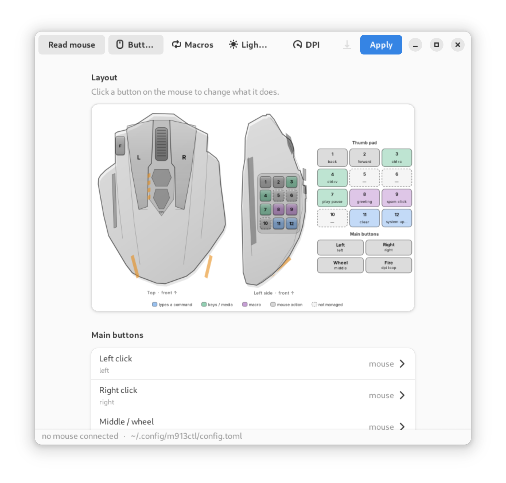
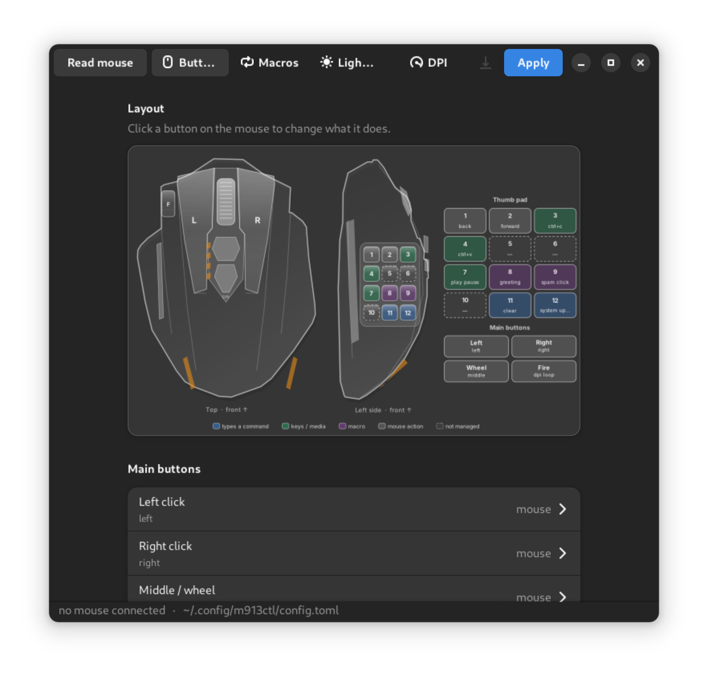
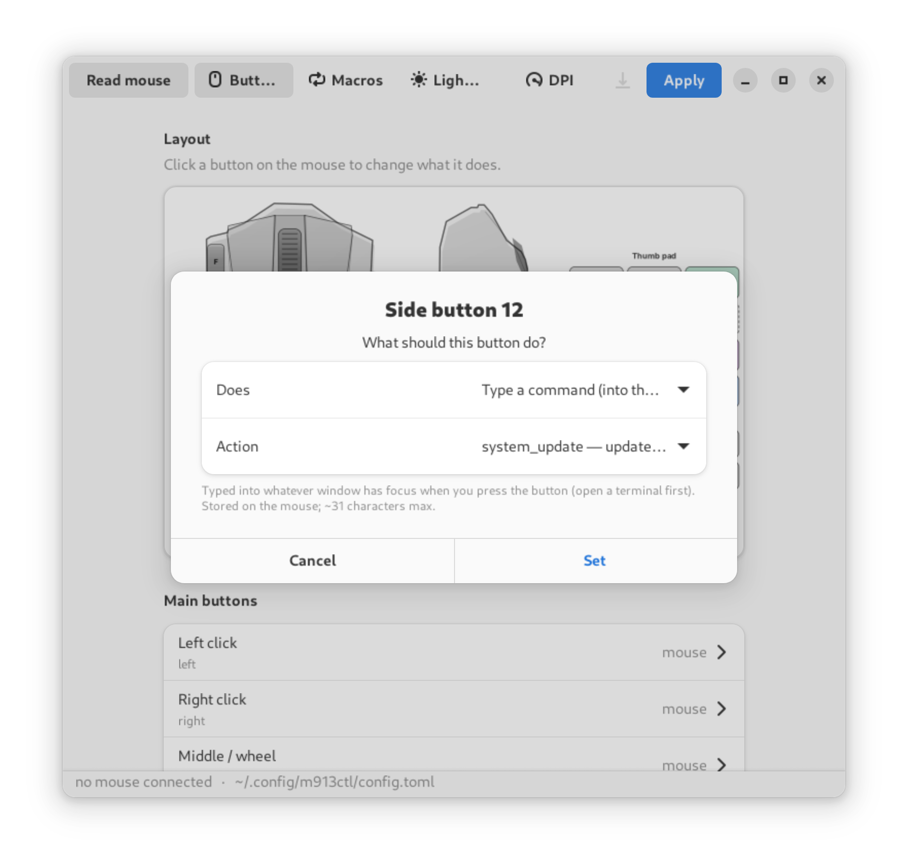
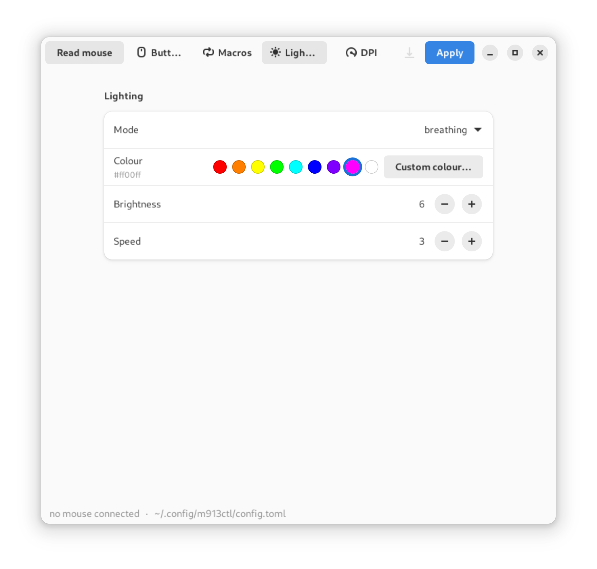
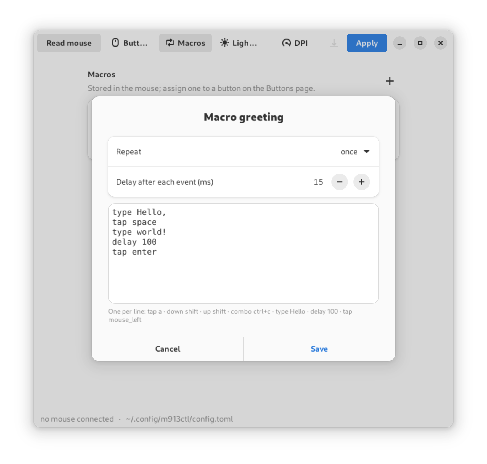
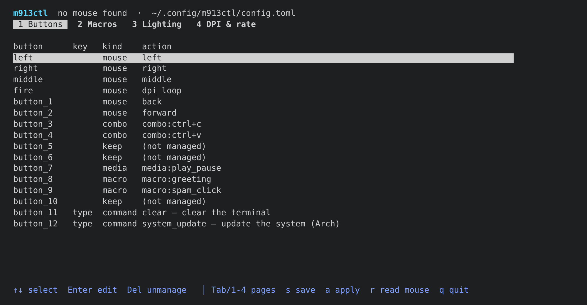

# m913ctl

**Configure a Redragon M913 gaming mouse on Linux — buttons, macros, DPI and
lighting — without the Windows software.**


> [!IMPORTANT]
> Unofficial project. It is **not affiliated with, authorised by or endorsed
> by Redragon**, and is not supported by them in any way. It contains no
> vendor code or files.

> [!CAUTION]
> This writes directly to your mouse's onboard memory. A bad or interrupted
> write can misconfigure the mouse or, in the worst case, leave it unusable.
> There is **no warranty, especially against damage to the hardware** — use it
> at your own risk. Make a backup first (see [Backup and
> restore](#backup-and-restore)) and keep it safe.

The M913 is a 16-button mouse whose buttons, macros, DPI and RGB can only be
set from a Windows app. m913ctl does it from Linux instead. It writes your
settings into the mouse's own memory, so they stick on any computer — no
driver, no background process.

- One config file, three ways to edit it: the command line, a terminal UI
  (`m913ctl tui`) and a GTK app (`m913ctl gui`).
- Bind buttons to clicks, keys, combos, media keys, macros or DPI steps. A
  side button can also type a shell command for you — that lives on the mouse
  too, so it needs nothing running and works on any desktop.
- Cable or 2.4 GHz dongle.
- Safe by default: it backs up before writing, only changes the fields you
  set, and reads everything back to confirm. `restore` undoes a bad write.
- Pure-Python core, standard library only, no root.

<p align="center">
  
  
</p>
<p align="center">
  
  
  
</p>
<p align="center">
  
</p>

Protocol notes are in [PROTOCOL.md](PROTOCOL.md), which also lists what
[mouse_m908](https://github.com/dokutan/mouse_m908) gets wrong for this mouse.

## Install (Arch)

```sh
git clone https://github.com/Zlee12/m913ctl && cd m913ctl
makepkg -si
sudo udevadm control --reload && sudo udevadm trigger
```

Re-plug the dongle or cable afterwards. The udev rule only gives the
logged-in user access to `25a7:fa07` and `25a7:fa08`.

To run it without installing: `python -m m913ctl …` from the checkout. You
still need the udev rule, or root.

## Use

The config lives in `~/.config/m913ctl/config.toml` unless you name another
file.

```sh
m913ctl tui                      # terminal UI
m913ctl gui                      # GTK window (python-gobject, gtk4, libadwaita)
m913ctl list                     # find the mouse
m913ctl info                     # sensor, rate, DPI level, battery
m913ctl dump -o mine.toml        # current active profile as a config
m913ctl check config.toml        # validate, no mouse needed
m913ctl apply -n config.toml     # show what would change
m913ctl apply config.toml        # back up, write, verify
m913ctl restore ~/.local/state/m913ctl/backup-….json
m913ctl actions | keys | presets | dpi-values
```

Writes go to the profile currently selected with the button on the mouse.

## Backup and restore

Every `apply` saves a backup of the mouse's current state **before** it writes
anything, as a timestamped JSON file under `~/.local/state/m913ctl/`:

```
~/.local/state/m913ctl/backup-20261106-130500.json
```

A backup is a full dump of the memory m913ctl manages — every button, key
action, macro, DPI level, report rate and the lighting — exactly as the mouse
held it at that moment. You can also make one by hand at any time:

```sh
m913ctl backup                   # -> ~/.local/state/m913ctl/backup-<time>.json
m913ctl backup -o original.json  # ...or wherever you want it
```

To put a saved state back on the mouse:

```sh
m913ctl restore ~/.local/state/m913ctl/backup-20261106-130500.json
m913ctl restore -n original.json   # dry run: show what would change first
```

`restore` writes the backup's fields, then reads them back to confirm — the
same safe path as `apply`.

**Keep your very first backup.** Before you change anything, run `m913ctl
backup -o factory.json` and store it somewhere safe. That file is your mouse's
original, out-of-the-box state; `m913ctl restore factory.json` returns the
mouse to it whenever you want. (m913ctl can't reset the mouse to Redragon's
defaults on its own — it can only restore a backup you made, so make that one
early.)

## Config

See [examples/config.toml](examples/config.toml). In short:

```toml
report_rate = 1000

[dpi]
levels = [800, 1600, 3200]
colors = ["ff0000", "00ff00", "0000ff"]

[led]
mode = "breathing"   # off static breathing rainbow
color = "ff00ff"
brightness = 6       # 1-10

[buttons]
button_1 = "back"
button_3 = "combo:ctrl+c"
button_7 = "media:play_pause"
button_10 = "macro:greeting"

[macros.greeting]
delay = 15
events = ["type Hello,", "tap space", "type world!", "delay 100", "tap enter"]
```

Buttons: `left right middle fire button_1 … button_12`. Actions:
`left right middle back forward none dpi_loop dpi_up dpi_down double_click
triple_click fire:<times>:<speed> rate_switch led_toggle profile_switch
key:<key> combo:<a>+<b> media:<name> macro:<name> raw:<3 bytes>`.

### Typed commands

The mouse can only send input, so it can't run a program by itself. A
`[commands]` entry stores, on the mouse, a macro that **types** the command
and presses Enter. Press the button with a terminal focused and it types the
command for you:

```toml
[commands]
button_12 = "preset:system_update"   # types: sudo pacman -Syu <Enter>
button_6  = "wpctl set-mute @DEFAULT_AUDIO_SOURCE@ toggle"
```

Because it's just a stored macro, this works on GNOME, KDE, Hyprland, Sway,
niri or X11 with nothing running. `m913ctl presets` lists the built-in ones.

**What to know about typed commands:**

- They type into **whatever window has focus** — open a terminal first. The
  mouse has no idea what's on screen; it just types.
- One button holds about **31 plain characters**, fewer with capitals or
  symbols (each needs an extra Shift press). The mouse stores a macro of at
  most 64 key events per slot. m913ctl works out the length and **refuses a
  command that won't fit**, with a clear error — so a short `sudo pacman -Syu`
  is fine, but `wpctl set-mute @DEFAULT_AUDIO_SOURCE@ toggle` is too long.
- The mouse has **16 macro slots total**, shared between typed commands and
  ordinary `[macros]`.
- The macro uses a US keyboard layout. On another layout the mouse still sends
  the same key positions, so symbols may come out differently.

For anything longer, for launching GUI apps, or for a shell alias, put the
long command behind a short one — e.g. make a shell function `up` and type
`up` — or bind a key/macro to the button and set the shortcut up in your
desktop.

### Macros

Macro events: `down`, `up`, `tap`, `combo`, `type` (US layout) and `delay`.
Use `repeat = 3`, `"hold"` or `"until_key"` to repeat a macro. A macro holds
up to **64 key events** (≈31 typed characters), and the mouse has **16 macro
slots**. The checker refuses a macro that leaves a key held down. It also
refuses a config that would leave no button doing left click, unless you pass
`--force`.

## Not done yet

- Writing to the inactive profiles. Switch profiles on the mouse and apply
  again.
- Macro names. Slots are written without a name, which the mouse never shows.
- Tested on one wired M913 (PMW3335, bcdDevice 1333): read, dump, LED,
  macro and key writes confirmed on hardware. The wireless dongle is
  untested. If something fails, run with `--debug`, which prints every
  packet. `restore` puts a backup back.

## Tests

```sh
python -m unittest discover -s tests -t .
```

The tests cover checksums and field encodings. Wherever mouse_m908 is
correct, they compare byte for byte against packets it produced
(`tests/golden_harness/` builds it against a stub libusb that logs every
packet). They also run apply, dump, backup and restore end to end against a
simulated mouse. With `pyte` installed, the TUI is driven in a
pseudo-terminal. The GTK tests need a display and run only with
`M913_GUI_TESTS=1`.

## Contributing

Bug reports, test results from other M913 variants (especially the wireless
dongle) and pull requests are welcome via the issue tracker. Please run the
test suite before opening a PR.

## Support

If m913ctl is useful to you, you can support its development here:

<a href="https://buymeacoffee.com/zlee12"></a>

## License

GPL-3.0-or-later. See [LICENSE](LICENSE). Thanks to
[mouse_m908](https://github.com/dokutan/mouse_m908) for the groundwork.

## Trademarks and legal

This is an independent, unofficial project. It is **not affiliated with,
authorised, sponsored or endorsed by Redragon** (Shenzhen Guanghui Technology)
or any of its affiliates. "Redragon" and "M913" are trademarks of their
respective owners and are used here only nominatively, to state which mouse
this software is compatible with. No Redragon logos or artwork are used.

m913ctl is an independently written program. It talks to the mouse over the
standard Linux HID interface to provide interoperability; it contains no code,
firmware or assets from any vendor. It is provided "as is", without warranty
of any kind (see the LICENSE). Use it at your own risk; `restore` puts a saved
backup back if a write goes wrong.
